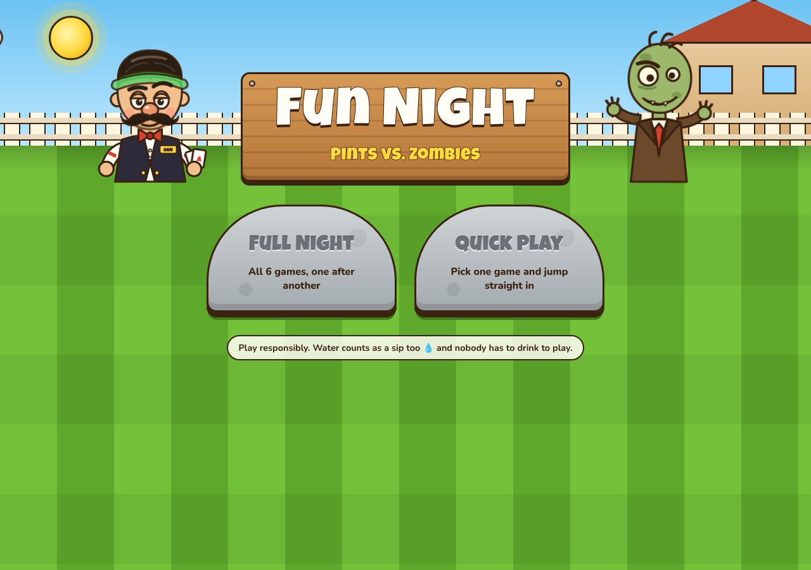
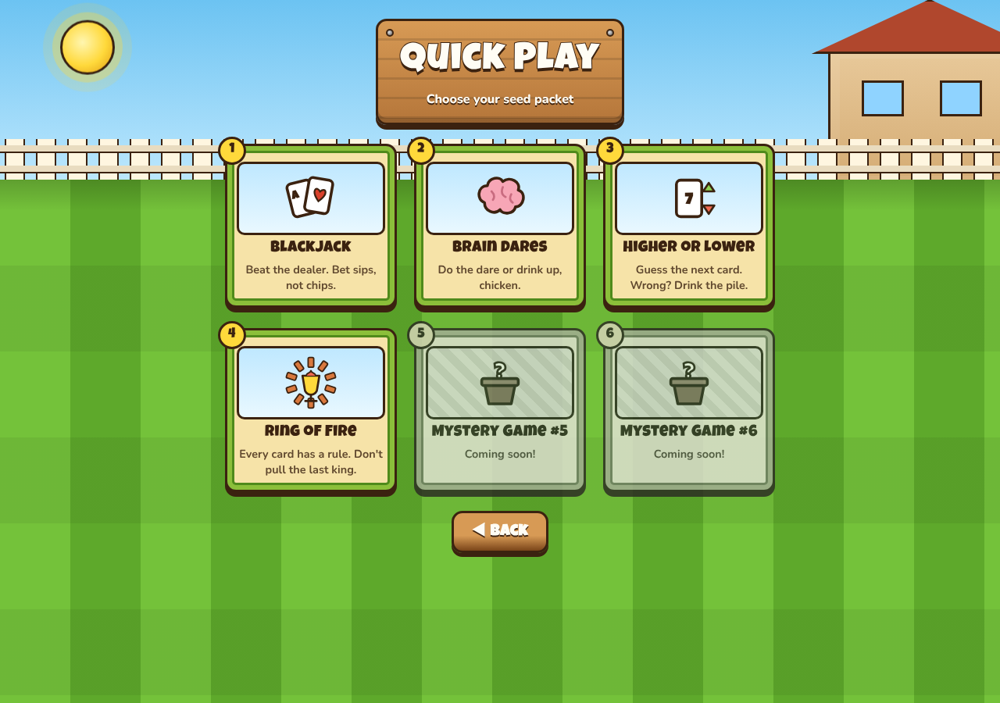
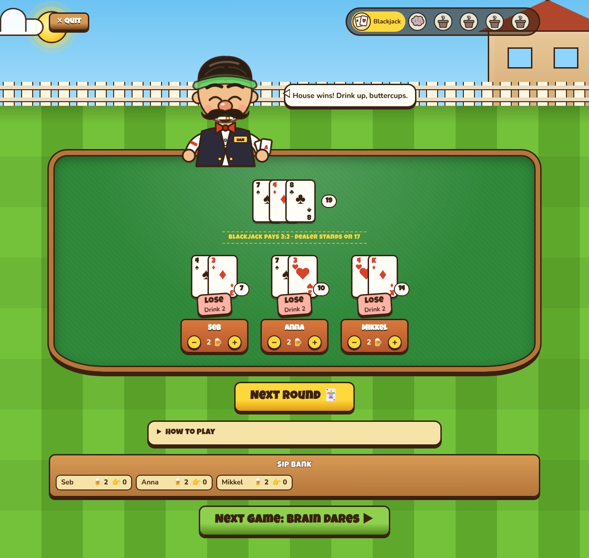
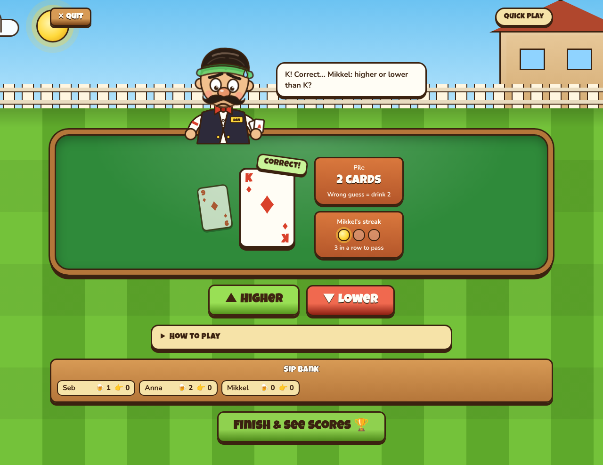
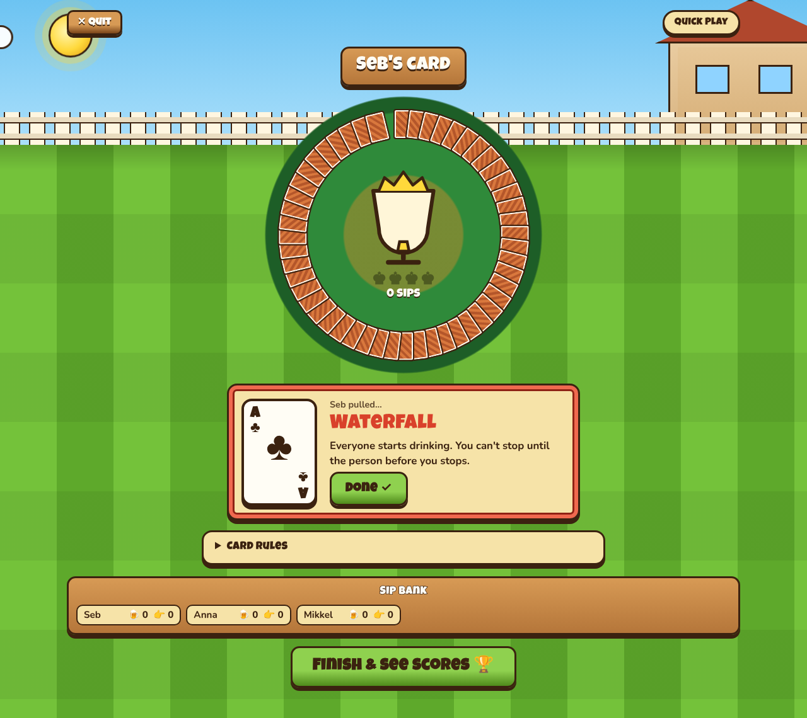

# Fun Night: Pints vs. Zombies

A party / drinking-game website for you and your friends, styled like a cartoon garden-defence game.
Start a **Full Night** to play all six games in a row, or use **Quick Play** to jump straight into one.
Either way you pick how many players there are (1–8) and enter their names first.

| Home | Quick Play | Blackjack |
| --- | --- | --- |
|  |  |  |

| Higher or Lower | Ring of Fire |
| --- | --- |
|  |  |

## The games

| # | Game | Status |
| - | ---- | ------ |
| 1 | **Blackjack**: bet 1–5 sips against Dealer Dan. Lose and you drink your bet, win and you hand it out (natural blackjack pays 3:2). Hit, stand or double down. The dealer always draws to 17. Lowkey casino jazz plays in the background (generated live in the browser; toggle it with the 🎷 button). | ✅ Playable |
| 2 | **Brain Dares**: take turns drawing a dare. Do it and hand out 1 sip, or chicken out and drink 3. | ✅ Playable |
| 3 | **Higher or Lower**: guess if the next card is higher or lower (aces high, same rank counts as wrong). Each right guess grows the pile; a wrong guess drinks 1 sip per card in the pile (max 5). Three right in a row and you can pass the pile on. | ✅ Playable |
| 4 | **Ring of Fire** (King's Cup): pull cards from a ring; every rank has a rule (Waterfall, You, Me, Floor, Mate, Rhyme, Question Master …). Kings fill the King's Cup, and whoever pulls the 4th king drinks it. | ✅ Playable |
| 5–6 | Mystery games | 🌱 Coming soon |

During a Full Night, games that aren't ready yet are skipped automatically. The **Sip Bank** tracks how many sips
everyone has drunk and handed out, and the night ends with awards and a rematch button.

## Running it locally

You need Java 17+, Node 20+ and npm.

```bash
# 1. Backend (http://localhost:8080)
cd backend/backend
./mvnw spring-boot:run

# 2. Frontend (http://localhost:5173), proxies /api to the backend
cd frontend
npm install
npm run dev
```

Open http://localhost:5173.

### Tests and checks

```bash
cd backend/backend && ./mvnw test      # game rules, sessions, API + security
cd frontend && npm run lint && npm run build
```

## How it fits together

```
frontend/ (React 19 + Vite)
  src/api/          fetch client + token storage
  src/pages/        Home, QuickPlay, Setup, Play, FinalScores
  src/games/        one folder per game + registry.js
  src/components/   Dealer, Zombie, SeedPacket, Scoreboard, LawnBackground …

backend/backend/ (Spring Boot 4, Java 17)
  game/        GameType enum: the six games and which are playable
  session/     sessions, players, session store, REST API
  cards/       shared deck: cards, ranks, suits, shuffled shoe
  blackjack/   hands, seats, rules, REST API
  dares/       Brain Dares rules + REST API
  higherlower/ Higher or Lower rules + REST API
  ringoffire/  Ring of Fire rules + REST API
  config/      CORS, security headers, rate limiting
  exception/   error types + global handler (RFC 9457 problem JSON)
```

All game logic runs on the server. The browser only gets what players are allowed to see (e.g. the dealer's
hole card is never sent until it's revealed).

### API

| Method | Path | What it does |
| ------ | ---- | ------------ |
| GET | `/api/games` | List the six games |
| POST | `/api/sessions` | Start a session: `{ "mode": "FULL" \| "QUICKPLAY", "gameId": "blackjack", "playerNames": [...] }`. Returns the session and a secret `token` |
| GET | `/api/sessions/{id}` | Session state + scores |
| POST | `/api/sessions/{id}/next` | Finish the current game, move to the next |
| DELETE | `/api/sessions/{id}` | End the session |
| GET/POST | `/api/sessions/{id}/blackjack`, `/deal`, `/action` | Play blackjack |
| GET/POST | `/api/sessions/{id}/dares`, `/draw`, `/resolve` | Play Brain Dares |
| GET/POST | `/api/sessions/{id}/higher-lower`, `/guess`, `/pass` | Play Higher or Lower |
| GET/POST | `/api/sessions/{id}/ring-of-fire`, `/draw`, `/resolve`, `/restart` | Play Ring of Fire |

Every `/api/sessions/{id}/**` call needs the `X-Session-Token` header.

### Security

- **Session tokens:** sessions use random UUIDs, and each one has a 256-bit secret token. Only a SHA-256 hash of the
  token is stored, and it is compared in constant time.
- **Server-authoritative games:** cards are shuffled with `SecureRandom`, and hidden information is never sent to the browser.
- **Input validation:** bean validation on every request body. Player names are whitelisted to letters, numbers,
  spaces and `_ . ' ! -` (max 20 characters) and must be unique.
- **Error handling:** errors come back as problem JSON with no stack traces or internals. Unexpected errors are only logged.
- **Limits:**
  - CORS only allows the configured frontend origin(s).
  - Security headers are set (`nosniff`, `X-Frame-Options: DENY`, CSP, `no-store`).
  - Session creation is rate-limited per client (20/min).
  - There's a cap on active sessions (5000), and idle sessions expire after 6 hours.

### Scaling

Sessions live behind the `SessionStore` interface (`InMemorySessionStore` by default), so the API itself holds no
state. To run several backend instances behind a load balancer, add a shared implementation (Redis or a database).
Requests for the same session are serialized with a per-session lock, so simultaneous taps can't corrupt a game.

### Configuration

Set these in `application.properties` or as environment variables (e.g. `FUNNIGHT_CORS_ALLOWED_ORIGINS`):

| Property | Default |
| -------- | ------- |
| `funnight.cors.allowed-origins` | `http://localhost:5173` |
| `funnight.sessions.max-active` | `5000` |
| `funnight.sessions.idle-timeout` | `PT6H` |
| `funnight.rate-limit.sessions-per-minute` | `20` |

Frontend: set `VITE_API_BASE_URL` if the API isn't served from the same origin.

## Adding game 5–6

1. **Backend:** add the rules + a controller under `/api/sessions/{id}/<game>` (see `dares/` for a small example). Use
   `sessionService.withSession(...)` and `session.game(GameType.X, YourGame.class, ...)`. Then set the game's name and
   `available = true` in `GameType`.
2. **Frontend:** create `src/games/<game>/YourGame.jsx` and register it in `src/games/registry.js`. It receives
   `sessionId`, `token`, `players` and `onScoresChanged`.

---

Play responsibly. Water counts as a sip too, and nobody has to drink to play.
