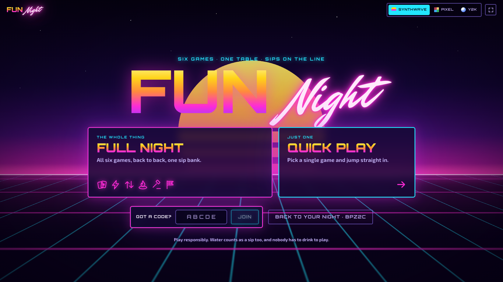
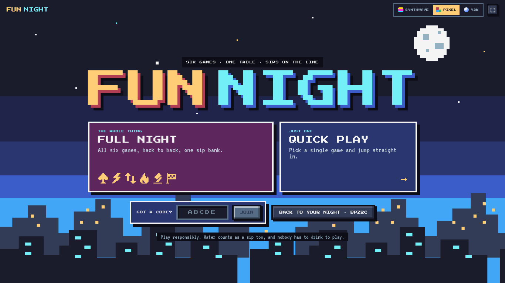
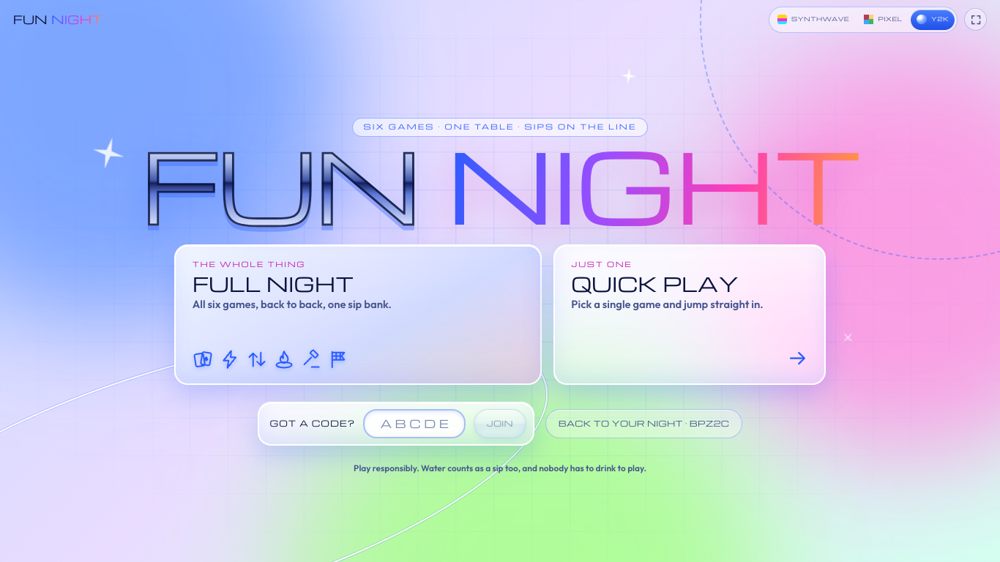
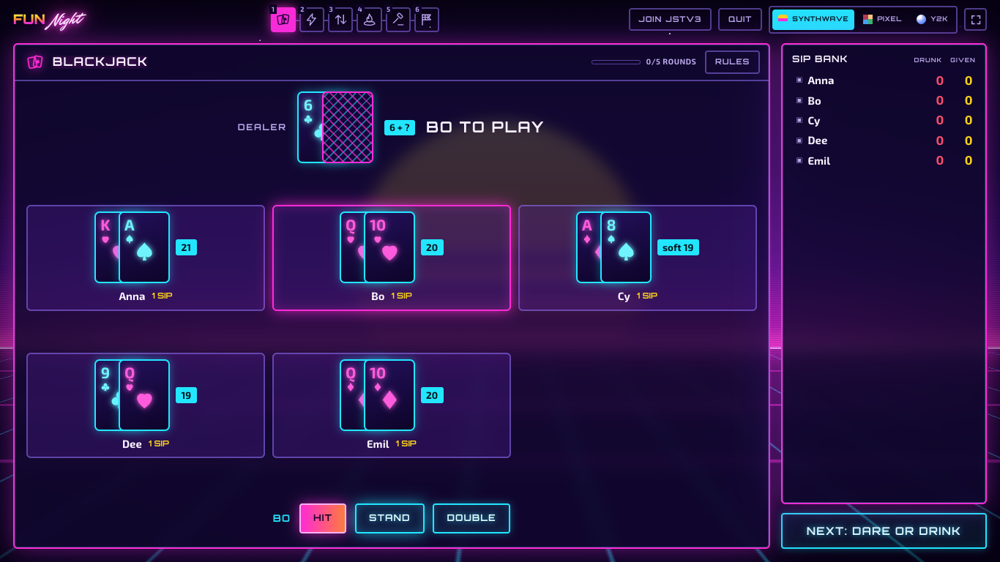
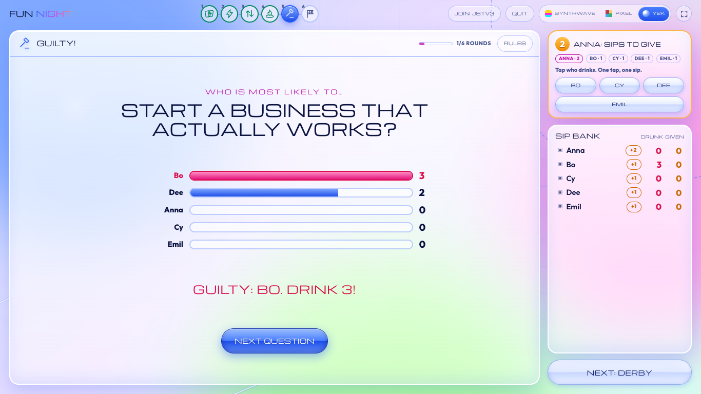
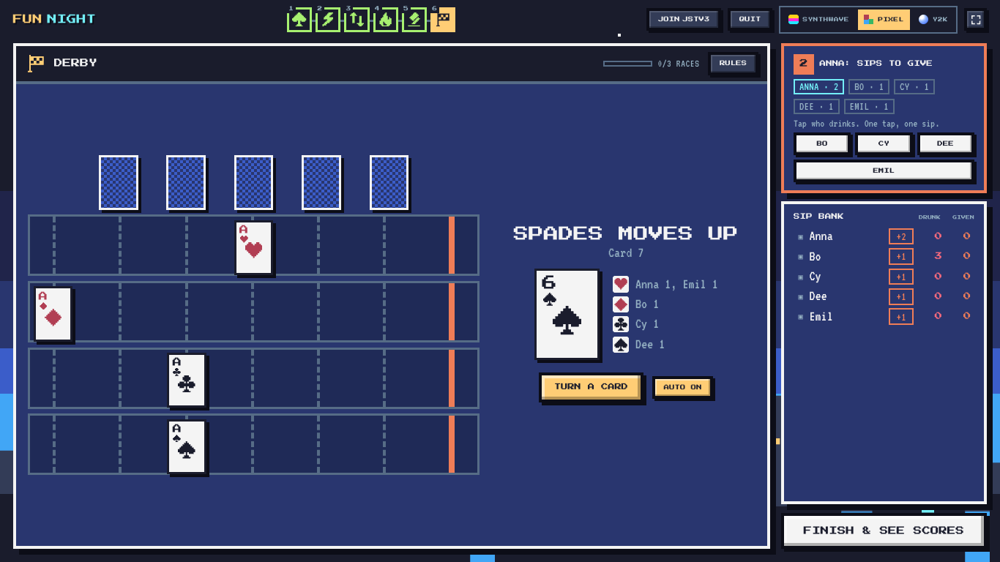

# Fun Night

A party / drinking-game website for you and your friends. Start a **Full Night** to play six games back to
back, or use **Quick Play** to jump straight into one. Play on a single shared screen, or let everyone scan a
QR code and play from their own phone while the big screen shows the table.

Six looks, switchable at any time and remembered per device: Synthwave, Pixel, Y2K, Kawaii, Undersea and
Runic. The first three:

| Synthwave | Pixel | Y2K |
| --- | --- | --- |
|  |  |  |

| Blackjack | Guilty! | Derby |
| --- | --- | --- |
|  |  |  |

## The games

| # | Game | How it works |
| - | ---- | ------------ |
| 1 | **Blackjack** | Bet 1–5 sips against the dealer. Lose and you drink your bet, win and you get it to hand out (a natural blackjack pays 3:2). Hit, stand or double down. |
| 2 | **Dare or Drink** | Pick a mild or a wild dare. Do it and you win sips to hand out; chicken out and you drink. Wild pays more and costs more. |
| 3 | **Higher or Lower** | Guess if the next card is higher or lower (aces high, same rank is wrong). Right guesses grow the pile; a wrong one drinks it (max 5). Three in a row and you can pass the pile on. |
| 4 | **Ring of Fire** | King's Cup: pull cards from a ring, every rank has a rule. Kings fill the cup and whoever pulls the 4th king drinks it. |
| 5 | **Guilty!** | A "who is most likely to…" question; everyone votes in secret. Most votes drinks one sip per vote (max 5). Needs 3+ players. |
| 6 | **Derby** | The four aces race. Back a suit, cards are turned and that suit's ace moves; hurdles make suits stumble. Backers of the winner hand out double, the rest drink. |

In a Full Night, a game the group is too small for is skipped. Each game shows a suggested length, but the
host decides when to move on (and is asked to confirm, because there's no going back).

### The Sip Bank

Every sip that is "given" is also a sip somebody drank. When you win sips they wait in the Sip Bank until you
tap who drinks them, so the scoreboard and the end-of-night awards always add up.

### One screen or many

- **One screen:** add everyone's name in the lobby and pass the device round.
- **Phones:** friends scan the QR code (or type the five-character code) and get their own seat. A phone only
  controls its own player; the host screen can always play any seat, so the night never stalls when a phone
  dies. Mid-game, a phone can take over any seat that's played on the host screen, and the host can take a
  seat back.

## Running it locally

You need Java 17+, Node 20+ and npm.

```bash
# 1. Server (http://localhost:8080)
cd server
./mvnw spring-boot:run

# 2. Web app (http://localhost:5173), proxies /api to the server
cd web
npm install
npm run dev
```

Open http://localhost:5173. To play from phones on the same wifi, nothing more is needed: the lobby's QR code
automatically points at your computer's wifi address. (Guest networks that isolate devices from each other
will block this; use a hosted copy instead, see below.)

### Tests and checks

```bash
cd server && ./mvnw test                               # game rules, rooms, persistence, API + security
cd web && npm run lint && npm test && npm run build    # lint, unit tests, production build
```

The same checks run on every push and pull request (`.github/workflows/ci.yml`).

## Hosting it

The Dockerfile builds one image that serves both the web app and the API:

```bash
docker build -t funnight .
docker run -p 8080:8080 -v funnight-data:/data funnight
```

Run it on any host that can run a container and put HTTPS in front of it. Run a single instance: rooms are
kept in memory (and snapshotted to the `/data` volume so a restart doesn't end the night).

## How it fits together

```
web/ (React 19 + Vite)
  src/api/          fetch client, live-update stream, what the device remembers
  src/lib/          room hook, themes, name rules, scoring helpers (+ unit tests)
  src/pages/        Home, QuickPick, Join, Lobby, Play, Final
  src/games/        one component per game + the registry (index.js)
  src/components/   cards, suits, icons, sip bank, QR code, dialogs, backdrop
  src/styles/       base.css (layout), games.css, themes/ (one file per look)

server/ (Spring Boot 4, Java 17)
  room/      rooms, seats, tokens, the sip bank, snapshots, live updates, REST API
  game/      the six games in order + the Game interface
  games/     blackjack, dares, higherlower, ringoffire, guilty, derby (rules + REST API each)
  cards/     cards, ranks, suits, shuffled decks
  content/   loads dares and prompts from resources/content/*.txt (one per line)
  config/    CORS, security headers, rate limiting, serving the web app
  common/    error type + global handler (RFC 9457 problem JSON)
```

All game logic runs on the server. A screen only gets what it's allowed to see: the dealer's hole card is
never sent until it's revealed, and nobody is ever sent who voted for whom in Guilty!.

Live updates use server-sent events: when a room changes, every connected screen gets a tiny "changed" ping
and fetches its own view. The stream reconnects by itself, with a slow poll as a safety net.

### API

| Method | Path | What it does |
| ------ | ---- | ------------ |
| GET | `/api/games` | List the six games |
| POST | `/api/rooms` | Open a lobby: `{ "mode": "FULL" \| "QUICKPLAY", "gameId": "blackjack", "playerNames": [...] }`. Returns the room and the host's secret `token` |
| GET | `/api/rooms/lookup?code=ABCDE` | What a phone sees before it has a seat |
| POST | `/api/rooms/join` | Take a seat: `{ "code", "name" }` (new seat, lobby only) or `{ "code", "seatId" }` (an open seat). Returns that phone's own `token` |
| GET | `/api/rooms/{id}` | The room as this screen may see it |
| GET | `/api/rooms/{id}/events` | Live "changed" pings (server-sent events) |
| POST | `/api/rooms/{id}/players` · DELETE `…/players/{playerId}` | Add a host-screen seat · remove a seat (lobby) or hand it back to the host (mid-game) |
| POST | `/api/rooms/{id}/start`, `/next`, `/rematch` | Host only: start, move to the next game, play again with the same crew |
| POST | `/api/rooms/{id}/handout` | Hand out won sips: `{ "playerId", "targetId", "sips" }` |
| DELETE | `/api/rooms/{id}` | Host only: end the night |
| POST | `/api/rooms/{id}/blackjack/bet`, `/deal`, `/action` | Play blackjack |
| POST | `/api/rooms/{id}/dares/draw`, `/resolve` | Play Dare or Drink |
| POST | `/api/rooms/{id}/higher-lower/guess`, `/pass` | Play Higher or Lower |
| POST | `/api/rooms/{id}/ring-of-fire/draw`, `/resolve`, `/restart` | Play Ring of Fire |
| POST | `/api/rooms/{id}/guilty/vote`, `/close`, `/next` | Play Guilty! |
| POST | `/api/rooms/{id}/derby/bet`, `/start`, `/flip`, `/again` | Play Derby |

Every `/api/rooms/{id}/**` call needs the `X-Room-Token` header. Every move returns the updated room.

### Security

- **Tokens:** the host and every phone get their own 256-bit secret token. Only SHA-256 hashes are stored and
  they are compared in constant time. A phone's token can only act for its own player; host-only actions
  (start, next, deal, end) need the host's token.
- **Join codes** are short on purpose, so guessing them is rate-limited per client (60 lookups/joins a minute).
- **Server-authoritative games:** decks are shuffled with `SecureRandom`, hidden information is never sent.
- **Input validation:** bean validation on every request body. Names are limited to letters, numbers, spaces
  and `_ . ' ! -` (max 20 characters) and must be unique at the table.
- **Error handling:** errors are problem JSON with no stack traces or internals.
- **Limits:** room creation is rate-limited (20/min per client), there's a cap on active rooms (5000), idle
  rooms expire after 6 hours, and security headers (`nosniff`, `X-Frame-Options: DENY`, CSP) are set on
  every response.
- **Behind a proxy** set `FUNNIGHT_FORWARD_HEADERS=native` (the Docker image does) so rate limiting sees the
  real client address instead of the proxy's.

### Configuration

Set these in `server/src/main/resources/application.properties` or as environment variables:

| Property | Env var | Default |
| -------- | ------- | ------- |
| `funnight.rooms.max-active` | `FUNNIGHT_ROOMS_MAX_ACTIVE` | `5000` |
| `funnight.rooms.idle-timeout` | `FUNNIGHT_ROOMS_IDLE_TIMEOUT` | `PT6H` |
| `funnight.rooms.data-dir` | `FUNNIGHT_DATA_DIR` | `data/rooms` (empty = memory only) |
| `funnight.rate-limit.rooms-per-minute` | `FUNNIGHT_RATE_LIMIT_ROOMS_PER_MINUTE` | `20` |
| `funnight.rate-limit.joins-per-minute` | `FUNNIGHT_RATE_LIMIT_JOINS_PER_MINUTE` | `60` |
| `funnight.cors.allowed-origins` | `FUNNIGHT_CORS_ALLOWED_ORIGINS` | `http://localhost:5173` (only used when the web app is on another origin) |
| `funnight.lan-discovery` | `FUNNIGHT_LAN_DISCOVERY` | `true` (the Docker image turns it off) |
| `server.forward-headers-strategy` | `FUNNIGHT_FORWARD_HEADERS` | `none` (the Docker image uses `native`) |

Web app: set `VITE_API_BASE_URL` at build time if the API isn't served from the same origin.

## Adding or changing things

- **More dares or questions:** add a line to `server/src/main/resources/content/dares-mild.txt`,
  `dares-wild.txt` or `guilty-prompts.txt`.
- **A new game:** on the server, add it to `GameType`, implement `Game` (see `games/dares` for a small one),
  add a controller that calls `rooms.play(...)`, and create it in `Games`. In the web app, add a component
  under `src/games/` and register it in `src/games/index.js`; it receives `{ room, game, me, send, busy }`.
- **A new look:** add a file under `web/src/styles/themes/` that sets the custom properties, add it to
  `src/lib/themes.js`, and give it a backdrop in `components/Backdrop.jsx`.

---

Play responsibly. Water counts as a sip too, and nobody has to drink to play.
